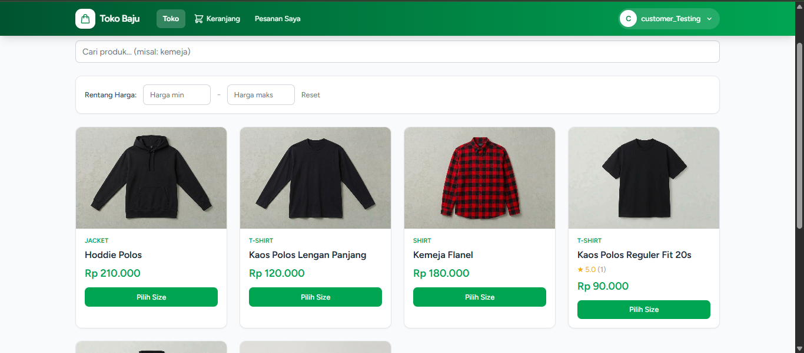
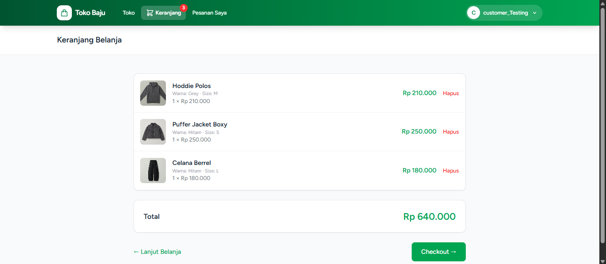
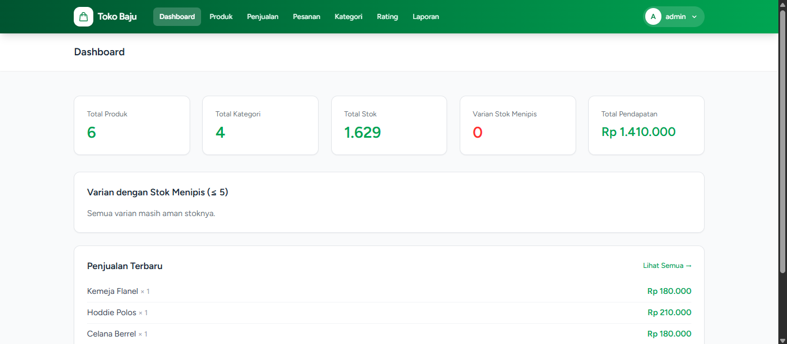
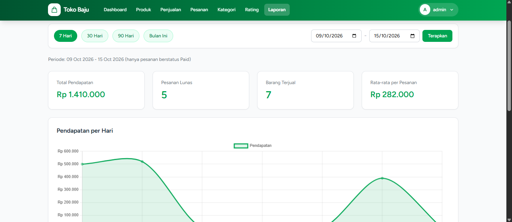

# Toko Baju

Aplikasi toko baju online berbasis **Laravel 12** dengan pembayaran **Midtrans**. Customer bisa memilih produk berdasarkan warna dan size, membayar lewat Midtrans, lalu melacak pesanannya. Admin mengelola produk, pesanan, pengiriman, dan melihat laporan penjualan.

## Fitur

### Customer
- Katalog produk dengan pencarian, filter kategori, dan filter rentang harga (tanpa reload halaman)
- Varian **warna + size**, masing-masing dengan stok sendiri
- Galeri foto per warna (foto berganti saat warna dipilih)
- Keranjang belanja dan checkout dengan **alamat pengiriman**
- Pembayaran lewat **Midtrans Snap** (sandbox/production)
- Riwayat pesanan, status pengiriman, nomor resi, dan tombol "Pesanan Diterima"
- Rating bintang untuk produk, hanya setelah pesanan diterima
- Registrasi, login, dan reset password (Laravel Breeze)

### Admin
- Dashboard: total produk, kategori, stok per varian, varian stok menipis, pendapatan
- Kelola produk (varian warna/size, stok, galeri) dan kategori
- Daftar dan detail pesanan, termasuk alamat penerima
- Pengaturan status pengiriman dan nomor resi
- Laporan penjualan dengan grafik (per hari, produk terlaris, per kategori, per warna)
- Daftar rating produk

### Keamanan dan keandalan
- Stok dikunci saat checkout (`lockForUpdate`) agar dua pembeli tidak bisa membeli stok terakhir bersamaan
- Stok dikembalikan otomatis jika pesanan kedaluwarsa, dibatalkan, atau ditolak
- Webhook Midtrans diverifikasi dengan signature dan aman dari pemrosesan ganda
- Halaman admin dilindungi middleware `admin`
- Pesanan hanya bisa dibuka oleh pemiliknya

## Teknologi

- PHP 8.2+, Laravel 12, Laravel Breeze
- MySQL
- Tailwind CSS, Alpine.js, Vite
- Chart.js (grafik laporan)
- Midtrans PHP SDK

## Kebutuhan sistem

- PHP 8.2 atau lebih baru (ekstensi: `mbstring`, `openssl`, `pdo_mysql`, `gd`, `fileinfo`)
- Composer
- Node.js 18+ dan npm
- MySQL / MariaDB (contoh: XAMPP)

## Instalasi

```bash
# 1. Clone repository
git clone https://github.com/USERNAME/NAMA-REPO.git
cd NAMA-REPO

# 2. Install dependensi
composer install
npm install

# 3. Salin file environment lalu buat app key
cp .env.example .env
php artisan key:generate
```

Di Windows PowerShell, ganti `cp` dengan `copy .env.example .env`.

```bash
# 4. Buat database kosong (misalnya: db_toko_baju), lalu sesuaikan DB_* di file .env

# 5. Jalankan migration dan buat symlink storage (untuk gambar produk)
php artisan migrate
php artisan storage:link

# 6. Build aset (untuk development bisa pakai: npm run dev)
npm run build

# 7. Jalankan server
php artisan serve
```

Buka `http://127.0.0.1:8000`.

## Konfigurasi `.env`

Sesuaikan bagian berikut:

```env
APP_URL=http://127.0.0.1:8000

DB_CONNECTION=mysql
DB_HOST=127.0.0.1
DB_PORT=3306
DB_DATABASE=db_toko_baju
DB_USERNAME=root
DB_PASSWORD=

FILESYSTEM_DISK=public

MIDTRANS_SERVER_KEY=isi-server-key-kamu
MIDTRANS_CLIENT_KEY=isi-client-key-kamu
MIDTRANS_IS_PRODUCTION=false
```

Setelah mengubah `.env`, jalankan `php artisan config:clear`.

## Membuat akun admin

Akun yang mendaftar lewat halaman register otomatis menjadi **customer**. Untuk menjadikan satu akun sebagai admin:

1. Daftar akun lewat halaman `/register`.
2. Buka Tinker:

```bash
php artisan tinker
```

3. Jalankan (ganti emailnya):

```php
\App\Models\User::where('email', 'emailkamu@gmail.com')->update(['role' => 'admin']);
```

4. Logout lalu login lagi. Akun akan masuk ke dashboard admin.

Role tidak bisa dipilih saat registrasi, sehingga tidak ada celah untuk mendaftar sebagai admin.

## Pengaturan Midtrans

1. Daftar di [Midtrans Sandbox](https://dashboard.sandbox.midtrans.com) dan ambil **Server Key** serta **Client Key** di menu *Settings, Access Keys*.
2. Isi kunci tersebut di file `.env`.
3. Midtrans harus bisa mengirim notifikasi ke aplikasi kamu. Saat development di komputer lokal, gunakan tunnel seperti [ngrok](https://ngrok.com):

```bash
ngrok http 8000
```

4. Di dashboard Midtrans, menu *Settings, Payment, Notification URL*, isi:

```
https://URL-NGROK-KAMU/midtrans/webhook
```

5. Samakan `APP_URL` di `.env` dengan URL ngrok, lalu jalankan `php artisan config:clear`.

Catatan: pada ngrok versi gratis, URL bisa berubah setiap kali ngrok dijalankan ulang. Perbarui `APP_URL` dan Notification URL jika itu terjadi.

Untuk mengetes pembayaran, gunakan [Midtrans Payment Simulator](https://simulator.sandbox.midtrans.com).

## Alur pesanan

```
Checkout (stok dikunci, pesanan "pending")
  -> Bayar di Midtrans
  -> Webhook: status "paid", pengiriman "diproses"
  -> Admin mengisi kurir dan nomor resi, status "dikirim"
  -> Customer menekan "Pesanan Diterima", status "selesai"
  -> Customer dapat memberi rating
```

Jika pembayaran tidak dilakukan sampai batas waktu (60 menit), pesanan ditandai kedaluwarsa dan stok dikembalikan.

## Scheduler (opsional)

Beberapa proses otomatis dijalankan lewat scheduler Laravel:

| Command | Fungsi |
|---|---|
| `orders:auto-shipping` | Pesanan berstatus dikirim lebih dari 7 hari otomatis menjadi selesai |
| `orders:auto-shipping --demo` | Simulasi pengiriman dengan resi palsu, khusus demo |
| `orders:release-expired` | Mengembalikan stok pesanan pending yang melewati batas bayar |

Selama development, jalankan:

```bash
php artisan schedule:work
```

Di server produksi, jalankan `php artisan schedule:run` setiap menit lewat cron atau Task Scheduler.

## Akun untuk mencoba

Buat dua akun supaya mudah menguji kedua peran:

| Peran | Cara |
|---|---|
| Admin | Daftar, lalu ubah role lewat Tinker (lihat bagian *Membuat akun admin*) |
| Customer | Daftar lewat halaman register |

## Catatan keamanan

- Jangan pernah meng-commit file `.env` atau kunci Midtrans. File `.env` sudah diabaikan lewat `.gitignore`.
- Untuk produksi, gunakan:

```env
APP_ENV=production
APP_DEBUG=false
APP_URL=https://domain-kamu
MIDTRANS_IS_PRODUCTION=true
```

- Gunakan kunci Midtrans **production**, SMTP sungguhan (`MAIL_*`), dan password database yang kuat.

## Struktur penting

```
app/Http/Controllers/        Cart, Checkout, Shop, Product, Category, Review, Report, Midtrans webhook
app/Http/Controllers/Admin/  Pengelolaan pesanan admin
app/Models/                  Product, ProductSize, ProductImage, Order, OrderItem, ProductReview, ...
app/Console/Commands/        Command pengiriman otomatis dan pelepasan stok
resources/views/             Tampilan Blade (shop, checkout, admin, auth, layouts)
routes/web.php               Semua route aplikasi
```
## Screenshot

| Toko | Checkout |
|------|----------|
|  |  |

| Dashboard Admin | Laporan |
|-----------------|---------|
|  |  |

## Lisensi

Project ini dibuat untuk keperluan Tertentu
